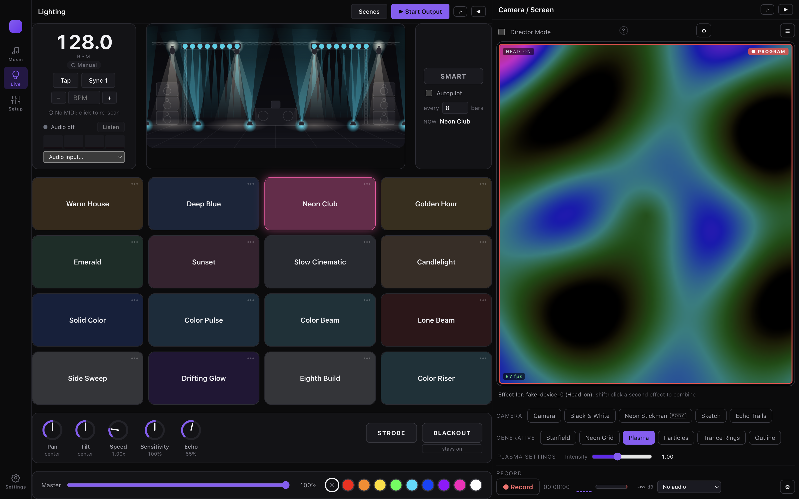
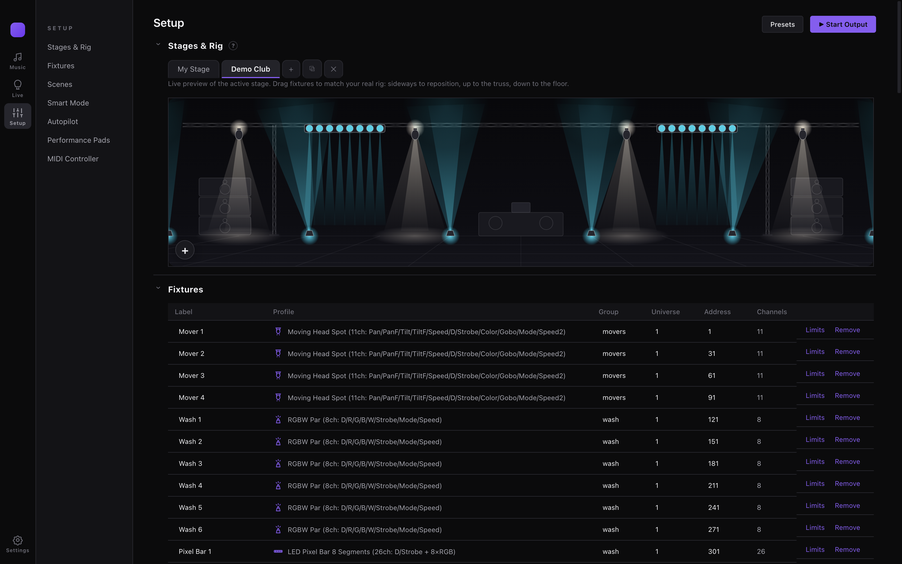
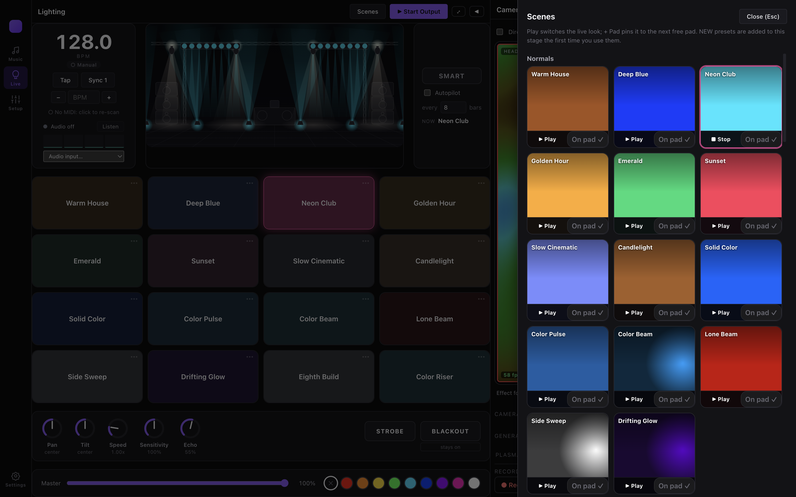
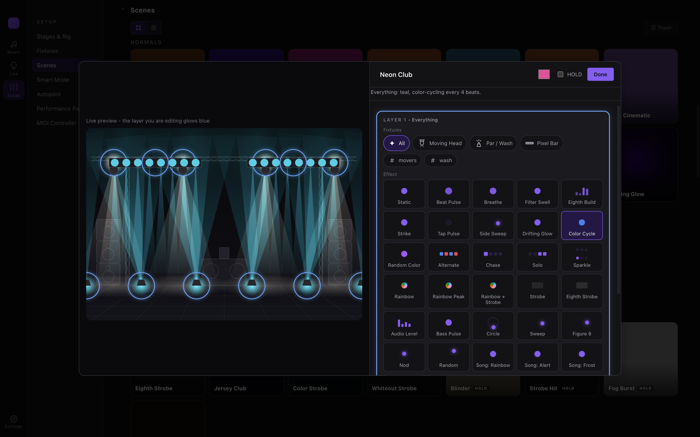
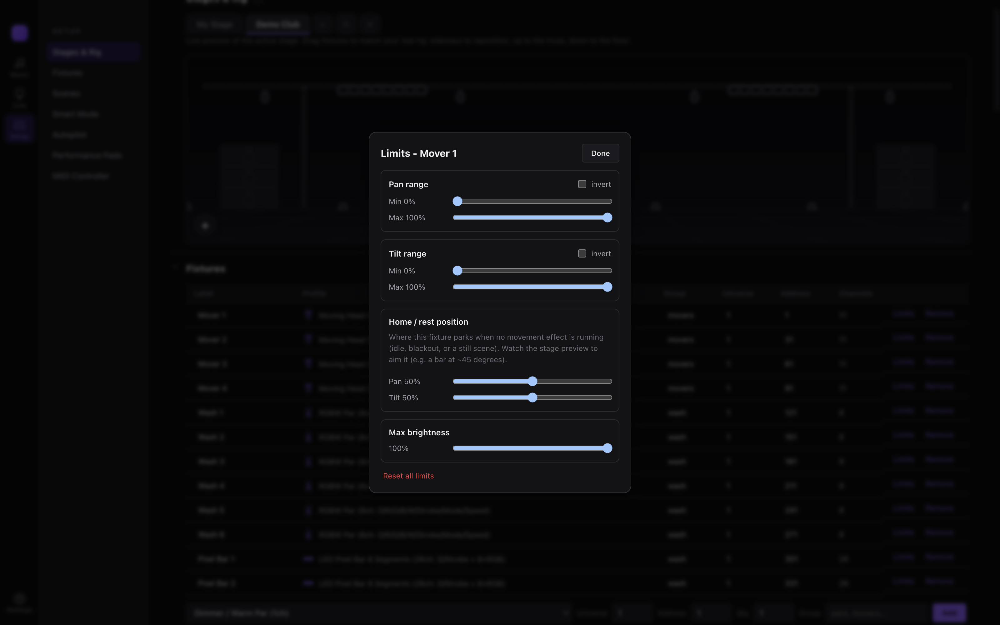
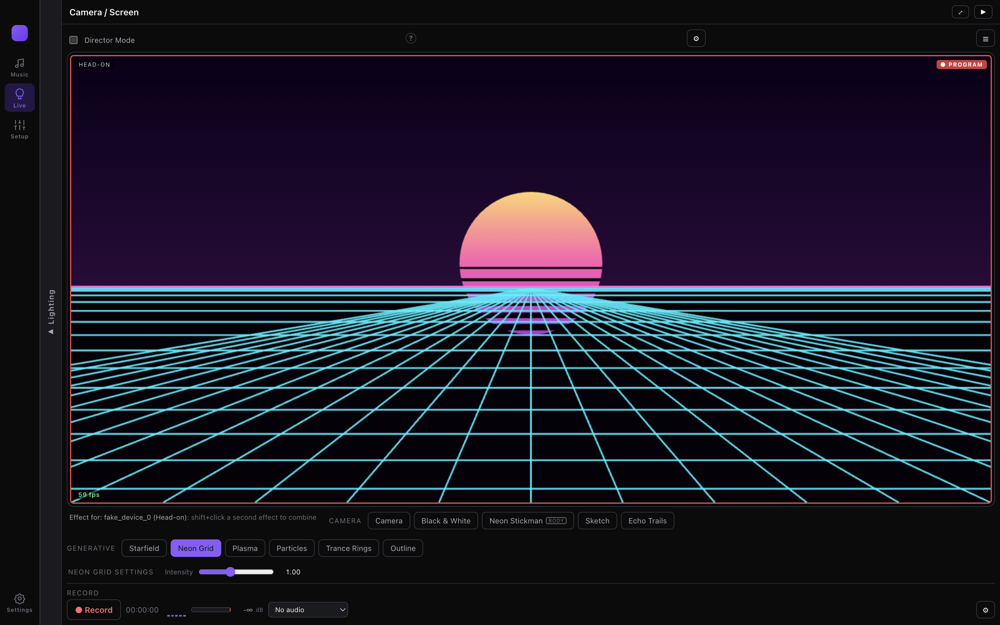
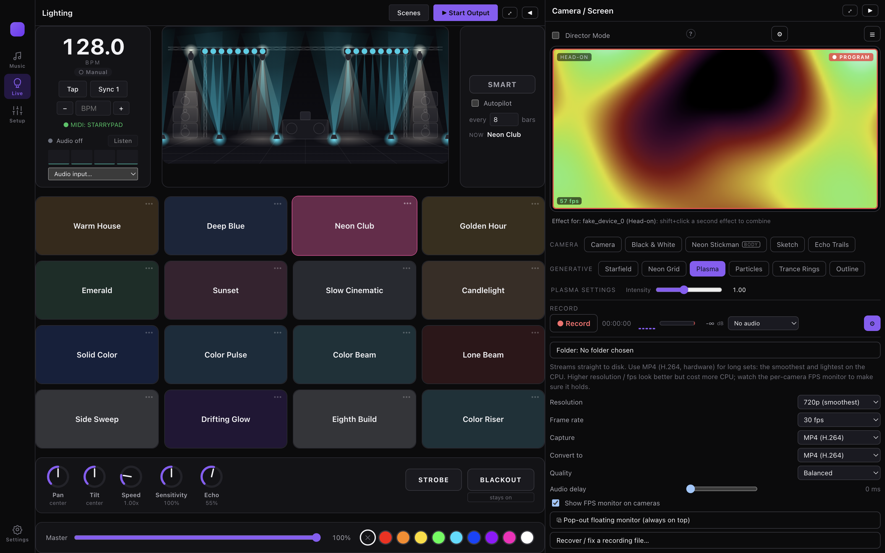
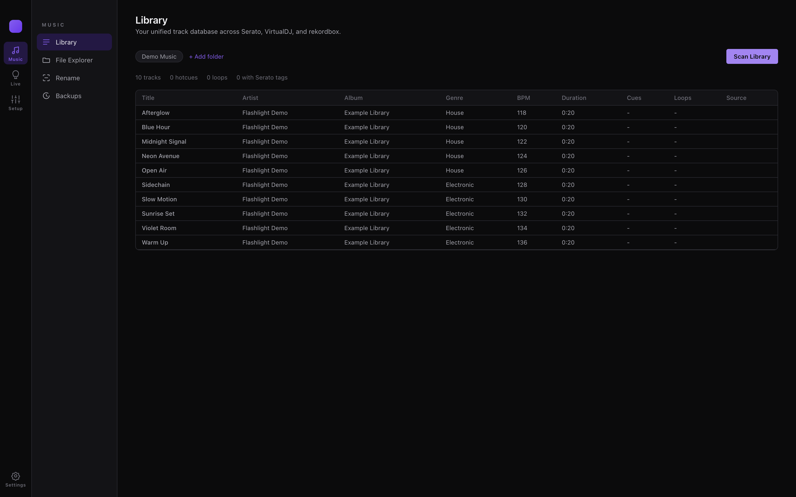

# Flashlight screenshot tour

[Back to the README](../README.md)

These screenshots show the running Electron app on macOS. The example stage contains
four moving heads, six RGBW washes, and two eight-segment pixel bars. Camera views use
Chromium's synthetic camera input; Plasma and Neon Grid are generated by Flashlight itself.
The library contains ten generated test tones with example metadata, not commercial songs.

DMX output was stopped during capture and configured for loopback. The images show the
interface and visual previews; they are not evidence of physical lighting, camera tracking,
or recording/export validation. No real music library or personal camera footage is included.

## Live cockpit

Run lighting and camera visuals side by side. Scene pads, tempo, movement knobs, master
brightness, and blackout stay within reach while the stage and video previews remain visible.

## Stage layout and fixture patching

Drag fixtures to match your stage and assign their profiles, groups, universes, and addresses.
Save separate stages for different rigs or venues.

## Scene browser

Preview a look, play it immediately, or pin it to a free performance pad. Scroll through
Normals, Builds, Flashing, Peaks, Adaptive, and Experimental categories. Scenes that need
unpatched fixture types appear separately.

## Scene editor

Target all fixtures, a fixture type, or a named group. Build layers with color, movement,
and rhythm effects while previewing the selected layer on the stage.

## Fixture limits

Set pan and tilt ranges, invert either axis, choose a resting position, and cap brightness
for each fixture. Check the resulting motion with your physical hardware before a show.

## Generated visuals

Expand the camera pane when visuals are the focus. This is Flashlight's Neon Grid effect;
other generated choices include Starfield, Plasma, Particles, and Trance Rings.

## Recording tools

Choose resolution, frame rate, capture format, conversion format, and quality. Optional
audio delay helps align the recording, and the recovery tool can repair a recording file.
Codec availability depends on Chromium and the operating system.

## Music library

Scan configured folders to inspect track titles, artists, albums, genres, tempos, durations,
and supported cue/loop metadata. The sample below contains generated audio with no cues.
Cross-platform cue writing and rekordbox export are not connected to the UI yet.

## More detail

- [Lighting and hardware](LIGHTING.md)
- [Cameras and recording](CAMERA_AND_RECORDING.md)
- [Music-library tools](LIBRARY_TOOLS.md)
- [Setup and first run](SETUP.md)
